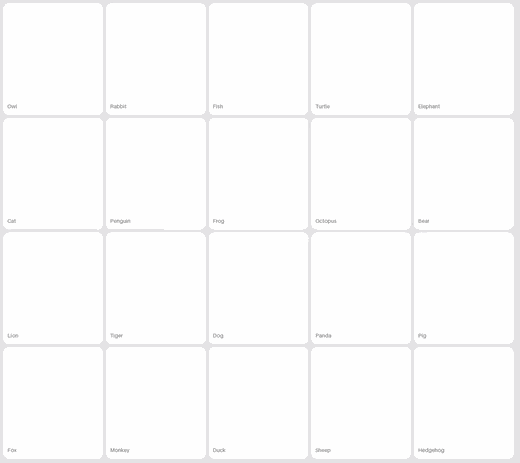

# dither_animals

[](https://pub.dev/packages/dither_animals)
[](https://opensource.org/licenses/MIT)
[](https://flutter.dev)
[](https://github.com/ayan15888/dither_animals)

Cute animated dithered (stipple, halftone, and ordered-dither) animal widgets for Flutter.

<p align="center">
  <a href="https://github.com/ayan15888/dither_animals/raw/main/doc/animal_details.mp4">
    
  </a>
</p>

<p align="center">
  <sub>🎬 <i>Click the preview above or <a href="https://github.com/ayan15888/dither_animals/raw/main/doc/animal_details.mp4"><b>watch full HD video (animal_details.mp4)</b></a></i></sub>
</p>

Rendered entirely on the Flutter `Canvas` using an **ordered 8×8 Bayer dithering matrix**, each animal features its own handcrafted animation curves, unique entrance/reveal transitions, facial expressions, idle breathing/swaying, and interactive poke physics with haptic feedback.

---

## ✨ Features

- 🐾 **50 Handcrafted Chibi Animals & Elements**: From owls, cats, and frogs to whales, pandas, and flamingos.
- 🎨 **Ordered Bayer 8×8 Matrix Dithering**: Authentic retro stipple rendering with smooth multi-layer density shading.
- 🕹️ **Interactive Poke Shockwaves**: Tap any animal to send an interactive radial wave ripple through the stipple grid, accompanied by haptic click feedback.
- 🔲 **Multiple Dot Styles**: Choose between crisp retro `DitherDot.square` pixels or organic halftone `DitherDot.round` circles.
- 🔄 **Motion Modes**: Seamless infinite animations (`DitherMotion.loop`) or one-time build entrances (`DitherMotion.once`).
- 🖼️ **Custom Image Dithering**: Pass any Flutter `ImageProvider` to dither and animate custom logos, avatars, or artwork.
- ⚡ **Lightweight & High Performance**: Vector paths sampled and dithered with hardware acceleration.

---

## 📦 Installation

Add `dither_animals` to your `pubspec.yaml` dependencies:

```yaml
dependencies:
  dither_animals: ^1.0.0
```

Or run:

```bash
flutter pub add dither_animals
```

Then import the package in your Dart code:

```dart
import 'package:dither_animals/dither_animals.dart';
```

---

## 🚀 Quick Start

Display an animated owl with default settings:

```dart
import 'package:dither_animals/dither_animals.dart';
import 'package:flutter/material.dart';

class OwlExample extends StatelessWidget {
  const OwlExample({super.key});

  @override
  Widget build(BuildContext context) {
    return const Center(
      child: SizedBox(
        width: 140,
        height: 140,
        child: DitherAnimal(
          animal: DitherAnimalType.owl,
          color: Color(0xFFFF5A1F),
        ),
      ),
    );
  }
}
```

---

## 🦁 Built-in Animal Presets (30 Total)

| Animal | Enum | Personality & Motion |
|---|---|---|
| 🦉 Owl | `DitherAnimalType.owl` | Radial bloom, sways gently & blinks big round eyes |
| 🐘 Elephant | `DitherAnimalType.elephant` | Left-to-right sweep, swings trunk & flaps ears |
| 🐰 Rabbit | `DitherAnimalType.rabbit` | Bottom-up bounce, hops with twitching ears |
| 🐟 Fish | `DitherAnimalType.fish` | Right-to-left glide, undulating tail & blows bubbles |
| 🐢 Turtle | `DitherAnimalType.turtle` | Calm spiral reveal, paddles flippers smoothly |
| 🐱 Cat | `DitherAnimalType.cat` | Diagonal leap, playful tail swish & perked ears |
| 🐧 Penguin | `DitherAnimalType.penguin` | Bottom-up waddle, cute side-to-side shuffle |
| 🐸 Frog | `DitherAnimalType.frog` | Springy bottom bounce, big vertical hops |
| 🐙 Octopus | `DitherAnimalType.octopus` | Top-down drop, jets upwards with wavy tentacles |
| 🐻 Bear | `DitherAnimalType.bear` | Radial expand, rhythmic happy celebration dance |
| 🦁 Lion | `DitherAnimalType.lion` | Regal radial reveal, mane puff & roaring motion |
| 🐯 Tiger | `DitherAnimalType.tiger` | Stealth prowl, horizontal stalk & fierce eyes |
| 🐶 Dog | `DitherAnimalType.dog` | Happy tilt, fast tail wagging & eager ears |
| 🐼 Panda | `DitherAnimalType.panda` | Cozy chew, leisurely bamboo munching |
| 🐷 Pig | `DitherAnimalType.pig` | Bouncy snuffle, nose wiggle & floppy ears |
| 🦊 Fox | `DitherAnimalType.fox` | Sly diagonal sweep, fluffy bushy tail flick |
| 🐵 Monkey | `DitherAnimalType.monkey` | Dynamic swing, playful vine swaying |
| 🦆 Duck | `DitherAnimalType.duck` | Water wobble, rhythmic quacking & head bobbing |
| 🐑 Sheep | `DitherAnimalType.sheep` | Fluffy expansion, joyful springy boings |
| 🦔 Hedgehog | `DitherAnimalType.hedgehog` | Scuttle across, defensive bristle & twitch |
| ☀️ Sun | `DitherAnimalType.sun` | Solar flare burst, radiant rays wiggle & smile |
| 🌧️ Cloud | `DitherAnimalType.cloud` | Airy float, gently drizzles raindrops |
| 🌙 Moon | `DitherAnimalType.moon` | Sleepy twilight rock, glowing serene crescent |
| ⭐ Star | `DitherAnimalType.star` | Cosmic sparkle burst, bright twinkling rays |
| 👻 Ghost | `DitherAnimalType.ghost` | Ethereal float, undulating floating "boo!" |
| 🍄 Mushroom | `DitherAnimalType.mushroom` | Springy pop-up, bouncy jelly cap hop |
| 🌵 Cactus | `DitherAnimalType.cactus` | Desert ground reveal, resilient desert sway |
| 🤖 Robot | `DitherAnimalType.robot` | Vertical blinds scan, boot sequence & antenna pulse |
| 🚀 Rocket | `DitherAnimalType.rocket` | Fiery countdown, thruster rumble & blast-off |
| 🧁 Cupcake | `DitherAnimalType.cupcake` | Delicious drop, frosting swirl & jelly wobble |

---

## 🎛️ API Reference

### `DitherAnimal`

| Property | Type | Default | Description |
|---|---|---|---|
| `animal` | `DitherAnimalType` | `DitherAnimalType.owl` | The built-in animal type to render. |
| `color` | `Color` | `Color(0xFF1F3BFF)` | Primary ink / dot color. |
| `cells` | `int` | `96` | Number of dots across the grid (higher = finer stipple). |
| `dot` | `DitherDot` | `DitherDot.square` | Dot shape: `DitherDot.square` or `DitherDot.round`. |
| `dotScale` | `double` | `0.9` | Dot size scaling factor (0.0 to 1.0+). |
| `motion` | `DitherMotion` | `DitherMotion.loop` | `loop` (infinite animation cycle) or `once` (assemble and freeze). |
| `duration` | `Duration?` | `null` | Total loop duration. Defaults to the animal's natural tempo. |
| `phase` | `double` | `0.0` | 0..1 timing offset to stagger multiple animals out of sync. |
| `pokeable` | `bool` | `true` | When `true`, tapping triggers haptic feedback and a ripple wave. |
| `showFace` | `bool` | `true` | Draws glossy eyes, blush cheeks, and fine detail linework. |
| `sparkles` | `bool` | `true` | Emits a sparkle burst once the animal completes forming. |
| `shimmer` | `double` | `0.07` | Subtle edge flicker intensity while fully formed. |
| `image` | `ImageProvider?` | `null` | Custom image to dither instead of built-in animals. |
| `invertImage` | `bool` | `false` | Inverts image brightness when custom `image` is passed. |

---

## 🖼️ Custom Image Dithering

You can dither any custom bitmap or artwork (dark graphics on transparent or light backgrounds look best):

```dart
DitherAnimal(
  image: const AssetImage('assets/logo.png'),
  color: Colors.deepPurple,
  cells: 112,
  dot: DitherDot.round,
  motion: DitherMotion.loop,
)
```

---

## 📱 Interactive Example App

The repository includes a complete example gallery demonstrating all 30 animals, search filtering, dot style toggle, grid density sliders, and interactive poke animations.

To run the example app:

```bash
cd example
flutter pub get
flutter run
```

---

## 📄 License

This project is licensed under the MIT License - see the [LICENSE](LICENSE) file for details.
